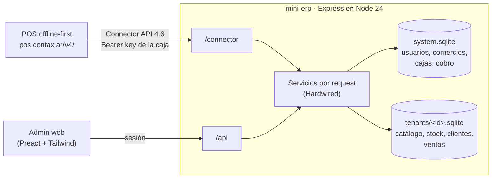
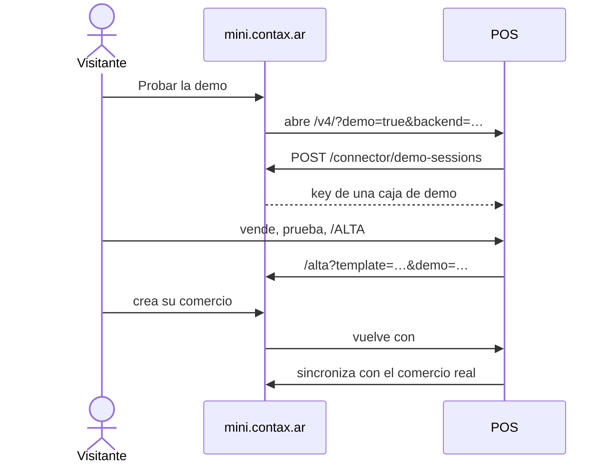

# mini contax · mini-erp

[](https://github.com/rauldiazsolis/mini-erp/actions/workflows/ci.yml)
[](https://github.com/rauldiazsolis/mini-erp/actions/workflows/deploy.yml)
[](https://mini.contax.ar)
[](https://mini.contax.ar)
[](./docs/connector-api.openapi.yaml)
[](./LICENSE)


**El backend de mini contax**: un sistema de gestión multitenant para comercios chicos, con un
admin web, que implementa el **Connector API** de
[offline-pos](https://github.com/rauldiazsolis/offline-pos), un POS web offline-first. Juntos son
**mini contax**: el POS vende en la caja (con o sin red) y mini lleva el catálogo, el stock, los
clientes, las ventas y la caja de cada comercio.

**Probalo**: en [mini.contax.ar](https://mini.contax.ar), "Probar la demo" abre el POS con una caja
de prueba en un comercio de ejemplo, sin registrarse; desde ahí, "Crear mi comercio" da de alta uno
real.

## Qué hace

- **Comercios aislados**: una base SQLite por comercio, con roles (dueño, admin, empleado) e
  invitaciones por link.
- **Catálogo, stock y clientes**: grillas con edición en línea, stock por sucursal con kardex,
  cuentas corrientes, cobranzas e importación desde CSV (el Excel en castellano también).
- **Ventas & Caja**: lo que vendió cada caja del POS, por día, con su resumen y sus medios de pago.
- **Cajas del POS**: cada caja con su key, ligada a su equipo; el POS sincroniza por lotes y el
  backend nunca rechaza una venta, solo avisa.
- **Uso y pagos**: un cargo por caja y día con ventas, créditos pagados y bonos, deuda con gracia.
- **Demos y alta**: una caja de demo por visitante en un comercio de ejemplo por rubro, y de la demo
  al alta de un comercio real que vuelve al POS ya conectado.
- **Portal**: desde el POS, `/MINI` abre "mi caja" de solo consulta.
- **Plataforma** para el equipo: comercios, usuarios, suspensiones, impersonación con auditoría,
  pedidos de ayuda, demos y el embudo de visitantes.
- Anda en el teléfono: tarjetas, filtros plegables y listas por tramos.

## Cómo encaja





El contrato lo define y lo publica offline-pos; acá hay una copia bajada del canal publicado
([`docs/connector-api.openapi.yaml`](./docs/connector-api.openapi.yaml), con su procedencia en
[`contract.json`](./contract.json)), que se actualiza con `pnpm contract:update [canal]`. Implementa
el contrato **4.6.0** con las capacidades `customer-payment-void`, `demo-sessions` y `portal`.

## Levantarlo

Requiere Node 24 y pnpm 10.

```bash
pnpm install
pnpm dev
```

El servidor queda en `http://localhost:4100` (o en el puerto de `PORT`): el landing en `/`, el admin
en `/admin`, el alta en `/alta`, la plataforma en `/plataforma`, la API del admin en `/api` y el
Connector API en `/connector`. Los datos van a `data/` (o a `DATA_DIR`).

Fuera de producción, el arranque siembra datos de desarrollo si no existen y los lista en la consola:
usuarios con la contraseña `admin123` (`root@local.test`, `soporte@local.test`, `dueno-a@local.test`
y otros), un comercio por rubro con 30 días de ventas y cajas con key fija (`mpos_dev_demo_key_12345`
es la Caja 1 del Kiosco). Para sembrar de nuevo, se borra la carpeta de datos. Con
`NODE_ENV=production` no se crea nada de eso; el `root` se crea una vez con
`node scripts/create-root.ts` (pide email, nombre y una contraseña de al menos 8 caracteres).

En desarrollo, "Probar la demo" abre una copia local del POS publicado que el mini-erp sirve en
`/pos/v4/` (mismo origen, sin CORS ni service worker): `pnpm dev` la baja sola si falta y
`pnpm pos:mirror` la renueva. En producción abre `https://pos.contax.ar/v4/`.

## Comandos

| Comando | Qué hace |
|---|---|
| `pnpm dev` | Servidor con recarga y el cliente por Vite |
| `pnpm lint` · `pnpm typecheck` · `pnpm test` | ESLint, TypeScript y Vitest |
| `pnpm build` · `pnpm start` | Build del cliente y servidor de producción |
| `pnpm test:e2e` | Playwright: demo, alta, portal, roles, plataforma y el teléfono, contra una base descartable en el puerto 4110 |
| `pnpm contract:update [canal]` | Baja el OpenAPI del canal publicado del POS |
| `pnpm pos:mirror [canal]` | Renueva la copia local del POS |
| `pnpm release:tag` | Crea y sube el tag de la versión de `package.json` (dispara el deploy) |

## Variables de entorno

| Variable | Por defecto | Qué controla |
|---|---|---|
| `NODE_ENV` | (vacío) | `production`: sirve el cliente compilado, abre el POS publicado y no siembra datos de desarrollo |
| `PORT` | `4100` | Puerto del servidor |
| `DATA_DIR` | `data` | Carpeta de las bases (`system.sqlite` y `tenants/`) |
| `BACKUP_DIR` | `backups` | Carpeta de los backups de `node scripts/backup.ts` (se guardan 7 días) |
| `PUBLIC_URL` | origen del request | URL pública del mini-erp, para los links que arma detrás de un proxy |
| `VITE_POS_URL` (al compilar) | `https://pos.contax.ar` | Origen del POS que abre el landing en producción (le suma el canal `/v4/`). En el deploy sale de la variable `POS_URL` del environment `production` |
| `DEMO_SESSIONS` | `on` | `off` apaga `POST /connector/demo-sessions` (404) y los comercios demo |
| `DEMO_TTL_HOURS` | `24` | Horas sin uso hasta que se cierra la caja de un visitante |
| `DEMO_RESET_HOUR` | `4` | Hora argentina del reinicio total diario de los comercios demo |
| `DEMO_MAX_ACTIVE` | `200` | Tope de cajas de demo activas (pasado el tope, 503) |
| `DEMO_RATE_LIMIT` | `10` | Demos por hora por IP (pasado el límite, 429 con `Retry-After`) |
| `AUTH_RATE_LIMIT` | `20` | Pedidos a login y alta cada 15 minutos por IP (contador compartido) |
| `CONTACT_RATE_LIMIT` | `5` | Pedidos de contacto por hora por IP |
| `BEACON_RATE_LIMIT` | `60` | Beacons del embudo por hora por IP (pasado el límite, se ignoran) |

## Producción

Publicado en **https://mini.contax.ar** (AWS Lightsail detrás de Caddy; `mini.contax.com.ar`
redirige ahí). Cada tag `v*` corre el CI entero y despliega por SSH, con migraciones en modo
mantenimiento y vuelta a la versión anterior si la nueva no responde. Backups: snapshots diarios de
Lightsail y una copia nocturna de las bases reales. La guía de operación está en
[`deploy/README.md`](./deploy/README.md).

## Documentación

| Para | Documento |
|---|---|
| Trabajar en el código | [`AGENTS.md`](./AGENTS.md): arquitectura, convenciones, estado y pendientes |
| Operar el servidor | [`deploy/README.md`](./deploy/README.md) |
| Entender una decisión | Las specs de [`docs/superpowers/specs/`](./docs/superpowers/specs/) |
| La historia de las fases | [`docs/historia.md`](./docs/historia.md) |
| El contrato con el POS | [`docs/connector-api.openapi.yaml`](./docs/connector-api.openapi.yaml) y la [guía para integradores](https://pos.contax.ar/v4/docs/) |

## Licencia

© 2026 Peky Diaz Solis. [GNU AGPL-3.0](./LICENSE). Podés usar, estudiar y modificar el código; si ofrecés una versión
modificada como servicio, tenés que publicar su código con la misma licencia.
